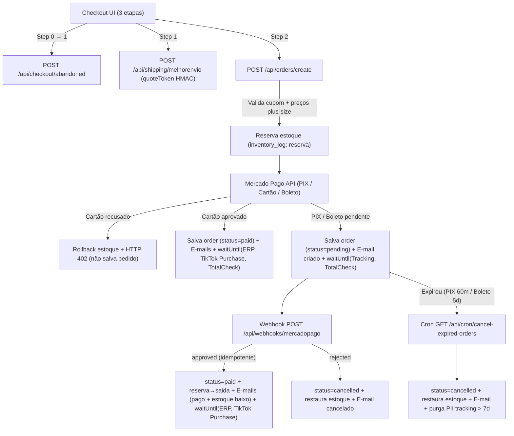
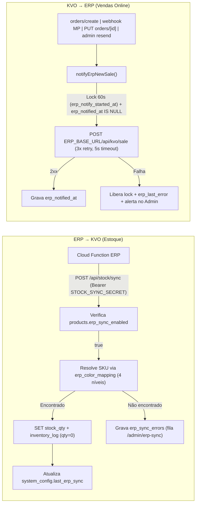
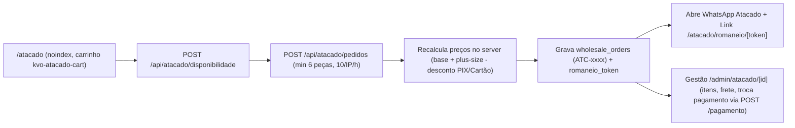
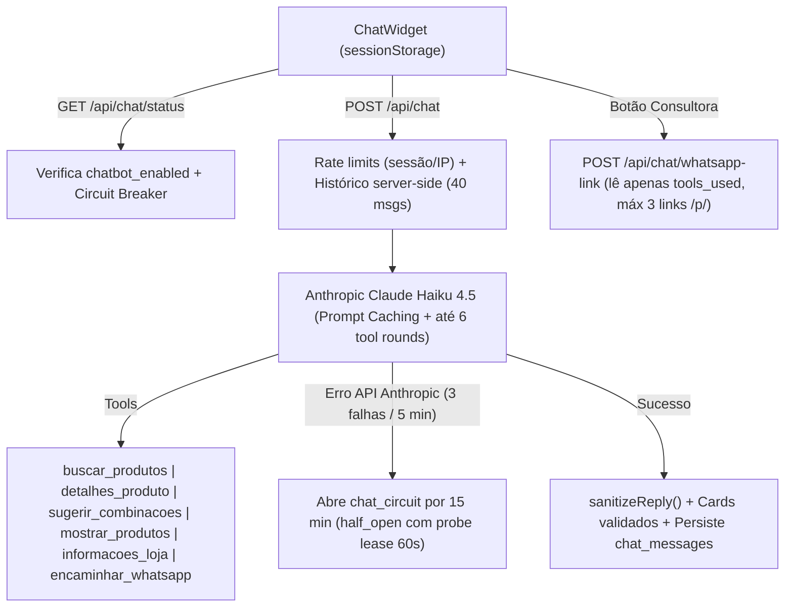

# Arquitetura Técnica — KVO (Kary Vendas Online)

Documentação técnica completa do repositório `kary-curadoria-shop` para desenvolvimento compartilhado entre agentes de IA e desenvolvedores.

---

## 1. Visão Geral da Stack e Organização

| Camada | Tecnologia | Detalhes |
| :--- | :--- | :--- |
| **Framework** | Next.js `14.2.35` (App Router) | React 18, TypeScript 5 (`strict: true`), `serverActions.bodySizeLimit: "10mb"` |
| **Estilização** | Tailwind CSS `3.4.1` | Tokens `kc` (`#A0622A`, `#5C3317`, `#EDE8DC`, `#F5F1EA`, `#B89070`), fontes `Cormorant Garamond` e `Jost` |
| **Estado Client** | Zustand `5.0.12` | `kvo-cart` (`lib/store/cart.ts`) e `kvo-atacado-cart` (`lib/atacado/cart-store.ts`) |
| **Banco / Auth / Storage** | Supabase (`@supabase/supabase-js` + `@supabase/ssr`) | PostgreSQL com RLS, Storage (`products`, `banners`) e Image Transformations (`format=webp`) |
| **Pagamentos** | Mercado Pago SDK v2 (`mercadopago` + `mp.fields`) | Checkout transparente PIX, Cartão de Crédito (e suporte backend a Boleto) + Webhook |
| **Frete / Logística** | Melhor Envio API v2 | Cotação (`/api/shipping/melhorenvio`) e geração de etiquetas no admin (`lib/melhorenvio-shipping.ts`) |
| **E-mail Transacional** | Resend + `@react-email/render` | 5 templates em `lib/email/templates/` |
| **IA (Chatbot)** | `@anthropic-ai/sdk` (`claude-haiku-4-5`) | Tool-use (6 ferramentas), Prompt Caching (`ephemeral`) e Circuit Breaker persistido |
| **Gráficos / Mídia** | `recharts`, `lucide-react`, `sharp` | Relatórios admin, ícones e redimensionamento de banners/favicons |
| **Infraestrutura** | Vercel (`@vercel/functions` `waitUntil`, Vercel Cron) | Cron horário em `vercel.json` (`/api/cron/cancel-expired-orders`) |

### Route Groups do App Router
- `app/(loja)/`: Vitrine B2C com `Navbar`, `Footer`, `WhatsAppFloat`, `FloatingCoupon` e `ChatWidget` (respeita `isStorePrelaunchActive()`).
- `app/atacado/`: Layout próprio isolado (sem componentes do varejo), com `(area)/` para o catálogo/pedido, `[token]/` para redirect legado `308` e `romaneio/[token]/` fora de `(area)` para impressão A4 limpa.
- `app/admin/`: `login/` público e `(authenticated)/` protegido por `middleware.ts` + `AdminLayoutShell` + `Sidebar` (com `prefetch={false}` e polling de badges a cada 60s via `/api/admin/sidebar-counts`).

---

## 2. Banco de Dados (Supabase PostgreSQL)

### 2.1 Tabelas Principais (Schema + Migrations + Tabelas Operacionais)

| Domínio | Tabelas | Origem / Notas |
| :--- | :--- | :--- |
| **Catálogo** | `categories` (`prefix`), `products` (`product_type`, `cost_price`, `erp_sync_enabled`, `notifica_erp_venda`, `atacado_enabled`, `tiktok_shop_url`), `product_variants` (`color`, `images[]`, `stock_qty`, `stock_min`), `product_bundle_items`, `colors`, `sizes` | `supabase/schema.sql` + migrations (`add_category_prefix`, `add_product_type_bundle`, `add_variant_images`, `products_atacado_enabled`, `tiktok_shop`) |
| **Varejo & Estoque** | `customers`, `orders` (`pagbank_charge_id`, `pagbank_status`, `installments`, `payment_type`, `erp_notified_at`, `erp_notify_started_at`, `erp_notify_attempts`, `erp_last_error`, `tracking_context`), `order_items`, `inventory_log`, `coupons`, `abandoned_checkouts`, `order_total_checks` | `schema.sql` + migrations (`add_abandoned_checkouts`, `add_order_total_checks`, `add_orders_tracking_context`, `orders_erp_notified_at`, `orders_installments_payment_type`) |
| **Atacado (B2B)** | `wholesale_orders` (`order_number` `ATC-0001`, `discount_snapshot`, `romaneio_token`, `ip_hash`), `wholesale_order_items` (`base_unit_price`, `price_overridden`), sequência `wholesale_order_seq` | `create_atacado.sql`, `atacado_preco_bruto.sql` |
| **CMS & Config** | `banners`, `nav_links`, `home_sections`, `system_config` (`plus_size_markup`, `tiktok_shop`, `last_erp_sync`, `atacado_*`, `chatbot_enabled`, `chatbot_limits`) | `create_banners.sql` e tabelas criadas no Supabase |
| **ERP Sync** | `erp_color_mapping`, `erp_sync_errors` | Mapeamento de cores e fila de SKUs não encontrados |
| **Chatbot IA** | `chat_conversations`, `chat_messages`, `chat_circuit` (`id = 1`), `chat_api_failures` | *(Sem arquivo `.sql` em `supabase/migrations/` — ver Seção 8)* |

### 2.2 Triggers Críticos
1. **`trg_order_status_change` → `fn_handle_order_status_change()`** (`fix_paid_status_inventory_transition.sql`):
   - Transição para `paid`: **não subtrai estoque novamente** (já reservado no checkout); apenas converte `inventory_log` de `type = 'reserva'` para `type = 'saida'` (`sales_channel = 'online'`).
   - Transição para `cancelled`: restaura `product_variants.stock_qty` (tratando `individual` e `conjunto`) e insere `inventory_log` com `type = 'ajuste'`.
2. **`trg_orders_updated_at` → `fn_orders_set_updated_at()`** (`orders_erp_notified_at.sql`):
   - Mantém `updated_at` inalterado quando o `UPDATE` em `orders` modifica **apenas** colunas `erp_*`, preservando `updated_at` como data de confirmação do pagamento.
3. **`trg_products_updated_at`, `trg_product_variants_updated_at`, `banners_updated_at`**: atualizam `updated_at = now()`.

### 2.3 Row Level Security (RLS)
- **Leitura pública (`anon` / `authenticated`):** apenas `categories`, `products`, `product_variants` e `banners` com `active = true`.
- **Somente Service Role (RLS ativo, sem policies públicas e/ou `REVOKE ALL`):** `coupons`, `inventory_log`, `abandoned_checkouts`, `order_total_checks`, `wholesale_orders`, `wholesale_order_items`, `chat_*`.
- **Admin:** operações administrativas rodam via `createAdminClient()` / `createNoStoreAdminClient()` (service role) após validação de sessão em `requireAdmin()`.

### 2.4 Storage e Otimização de Imagens
- **Buckets:** `products` (upload até 10 MB em `POST /api/admin/products/upload`) e `banners` (redimensionado via `sharp` para `1920×520` desktop e `1080×1350` mobile, ou upload direto via `POST /api/admin/banners/signed-url`).
- **Image Transformations (`lib/storage-image.ts`):** `optimizedImageUrl()` reescreve `/storage/v1/object/public/` para `/storage/v1/render/image/public/...?width=1080&quality=80&format=webp`, garantindo WebP para o crawler da Meta (que envia `Accept: */*`).

---

## 3. Clientes Supabase, Retry e Cache do Next.js

| Fábrica | Arquivo | Chave / Sessão | Bypass RLS | Quando usar |
| :--- | :--- | :--- | :---: | :--- |
| `createAdminClient()` | `lib/supabase/admin.ts` | `SERVICE_ROLE_KEY`, sem sessão | Sim | Operações server-side gerais (admin, webhooks, cron, ERP, sitemap). |
| `createNoStoreAdminClient()` | `lib/supabase/admin-no-store.ts` | `SERVICE_ROLE_KEY` + `fetch(..., { cache: "no-store" })` | Sim | **Obrigatório** para `system_config`, Atacado, Chatbot e Circuit Breaker (evita Data Cache do Next.js App Router). |
| `createAnonClient()` | `lib/supabase/anon.ts` | `ANON_KEY`, sem cookies | Não | Rotas públicas (`/api/products/search`, `/api/orders/status/[id]`, `/feed.xml`) sem interferência da sessão admin. |
| `createClient()` (server) | `lib/supabase/server.ts` | `ANON_KEY` + cookies (`@supabase/ssr`) | Não | Exclusivo para `requireAdmin()` (`lib/admin-auth.ts`). |
| `createClient()` (browser) | `lib/supabase/client.ts` | `ANON_KEY`, `autoRefreshToken: false` | Não | Exclusivo para login (`/admin/login`) e logout (`Sidebar`). |

- **Resiliência PostgREST (`lib/supabase/retry.ts`):** `withRetry()` intercepta `PGRST002` (schema cache recarregando) com até 2 retentativas (`500 ms`, `1500 ms`), usado em `/api/products` e `/api/categories`.
- **Política de Cache / ISR:**
  - `/api/admin/**`, `/api/stock/sync`, `/api/chat/*`, `/api/orders/[id]`, `/p/[ref]` e `/atacado/romaneio/[token]`: `dynamic = "force-dynamic"`, `Cache-Control: no-store`.
  - `/api/products` (`revalidate = 60`), `/api/products/[id]` (`revalidate = 30`), `/feed.xml` (`revalidate = 3600`).
  - `app/sitemap.ts`: timeout de 8s via `Promise.race` com fallback estático para não travar builds.

---

## 4. Segurança e Autenticação

1. **Páginas Admin (`middleware.ts`):** `matcher: ["/admin", "/admin/:path*"]`. Valida sessão via `supabase.auth.getUser()`, propaga cookies renovados inclusive em redirects e evita loop de login quando o Supabase Auth retorna `5xx`.
2. **APIs Admin (`lib/admin-auth.ts`):** `requireAdmin()` protege **todas as 45 rotas** em `app/api/admin/**` e operações de escrita/privadas em `/api/products*`, `/api/categories*` e `/api/orders*`.
3. **Autenticação S2S (Bearer Tokens):**
   - `lib/service-auth.ts` (`hasValidServiceSecret`): compara `STOCK_SYNC_SECRET` com `crypto.timingSafeEqual` (usado em `POST /api/admin/erp-sync/mapping`).
   - `POST /api/stock/sync`: valida `Authorization: Bearer <STOCK_SYNC_SECRET>`.
   - `lib/erp/notify-sale.ts`: envia `Authorization: Bearer <ERP_WEBHOOK_SECRET>`.
   - `GET /api/cron/cancel-expired-orders`: valida `Authorization: Bearer <CRON_SECRET>`.
4. **Assinaturas HMAC-SHA256 (chave derivada de `SUPABASE_SERVICE_ROLE_KEY`):**
   - `quoteToken` de frete (`lib/shipping-quote.ts`, TTL 24h, rótulo `kvo-shipping-quote-v1`).
   - `ip_hash` para rate limit do Atacado (10 pedidos/IP/hora) e do Chatbot (100 conversas/IP/dia, 60 msgs/IP/hora).
5. **Proteção de PII / LGPD:**
   - `GET /api/orders/[id]` retorna apenas `{ id, orderNumber, status, total, prazo, updatedAt }`.
   - `GET /api/orders/track` exige par `order_number` + `email` e omite dados sensíveis.
   - `orders.tracking_context` (IP/UA/`_ttp`/`ttclid`) é limpo imediatamente após envio do `Purchase` ao TikTok ou após 7 dias pelo cron (`purgeTrackingContext`).

---

## 5. Fluxos Ponta a Ponta

### 5.1 Fluxo de Pedido B2C, Pagamento, ERP e Cron

### 5.2 Sincronização Bidirecional ERP ↔ KVO

### 5.3 Fluxo Atacado (B2B)

### 5.4 Chatbot IA e Circuit Breaker

---

## 6. Mapa de Rotas e Scripts

### 6.1 Rotas Públicas e Webhooks
- **Páginas Loja (`app/(loja)/`):** `/`, `/produtos`, `/produtos/[slug]`, `/carrinho`, `/checkout`, `/checkout/pix`, `/checkout/sucesso`, `/rastrear`, `/retomar/[id]`, `/sobre`, `/trocas-e-devolucoes`, `/politica-de-privacidade`.
- **Páginas Atacado (`app/atacado/`):** `/atacado`, `/atacado/produto/[slug]`, `/atacado/pedido`, `/atacado/[token]` (redirect 308), `/atacado/romaneio/[token]`.
- **SEO / Feeds / Links Curtos:** `/sitemap.xml`, `/robots.txt`, `/feed.xml`, `/p/[ref]`, `/opengraph-image`.
- **APIs Públicas / S2S:**
  - Catálogo: `/api/products`, `/api/products/[id]`, `/api/products/[id]/variants`, `/api/products/search`, `/api/products/related`, `/api/products/variants/stock`, `/api/categories`, `/api/categories/[id]`, `/api/banners`, `/api/nav-links`, `/api/config/plus-size-markup`.
  - Checkout / Pedidos / Frete: `/api/cep`, `/api/shipping/melhorenvio`, `/api/coupons/validate`, `/api/coupons/floating`, `/api/checkout/abandoned`, `/api/checkout/resume/[id]`, `/api/orders/create`, `/api/orders/[id]`, `/api/orders/status/[id]`, `/api/orders/track`.
  - Atacado: `/api/atacado/disponibilidade`, `/api/atacado/pedidos`.
  - Chatbot: `/api/chat`, `/api/chat/status`, `/api/chat/whatsapp-link`.
  - Tracking / Webhooks / Cron / ERP: `/api/tracking/tiktok`, `/api/webhooks/mercadopago`, `/api/cron/cancel-expired-orders`, `/api/stock/sync`.

### 6.2 Painel Admin (`app/admin/` e 45 APIs em `app/api/admin/`)
- **Telas:** `/admin/login`, `/admin` (dashboard), `/admin/pedidos` (`/[id]`), `/admin/produtos` (`/novo`, `/[id]`), `/admin/estoque`, `/admin/categorias` (`/nova`, `/[id]`), `/admin/cores`, `/admin/tamanhos`, `/admin/banners`, `/admin/menus`, `/admin/home`, `/admin/configuracoes/plus-size`, `/admin/configuracoes/tiktok-shop`, `/admin/cupons`, `/admin/clientes` (`/[id]`), `/admin/atacado` (`/[id]`, `/configuracoes`), `/admin/abandonos`, `/admin/erp-sync`, `/admin/chatbot`, `/admin/relatorios`.
- **Grupos de APIs (`/api/admin/*`):** `stats`, `sidebar-counts`, `orders/[id]` (`address`, `label`, `erp-resend`), `products/upload`, `products/[id]/variants/[variantId]`, `sku/next`, `stock`, `colors`, `sizes`, `banners/*`, `home-sections/*`, `nav-links/*`, `config/plus-size-markup`, `config/tiktok-shop`, `coupons/*`, `customers/*`, `abandoned-checkouts`, `atacado/*`, `erp-sync*`, `chatbot/*`, `reports/*` (`sales`, `products`, `customers`, `payments`, `stock`).

### 6.3 Scripts CLI (`scripts/`)
- `scripts/consultar-parcelas-mp.mjs`: consulta read-only de parcelas no Mercado Pago via TSV (`order_number\tpagbank_charge_id`).
- `scripts/generate-favicon.mjs`: gera `favicon-16.png`, `favicon-32.png`, `apple-touch-icon.png` e `icon-512.png` a partir de `public/logo/Logo_Kary_Curadoria.jpeg`.
- `scripts/testar-links-curtos.mjs`: valida `/p/<ref>` simulando mobile (302 + UTMs) e crawler da Meta (`facebookexternalhit`, 200 + OG).

---

## 7. Variáveis de Ambiente

| Módulo | Variáveis | Escopo |
| :--- | :--- | :--- |
| **Supabase** | `NEXT_PUBLIC_SUPABASE_URL`, `NEXT_PUBLIC_SUPABASE_ANON_KEY`, `SUPABASE_SERVICE_ROLE_KEY` | Client / Server |
| **Mercado Pago** | `MERCADOPAGO_ENV`, `MERCADOPAGO_ACCESS_TOKEN_SANDBOX`, `MERCADOPAGO_ACCESS_TOKEN_PRODUCTION`, `NEXT_PUBLIC_MERCADOPAGO_PUBLIC_KEY` (+ fallbacks `_ENV`/`_PRODUCTION`/`_SANDBOX`) | Server / Client |
| **Melhor Envio** | `MELHORENVIO_ENV`, `MELHORENVIO_TOKEN_SANDBOX`, `MELHORENVIO_TOKEN_PRODUCTION`, `MELHORENVIO_CEP_ORIGEM`, `MELHORENVIO_CPF`, `MELHORENVIO_CNPJ` | Server |
| **Resend (E-mail)** | `RESEND_API_KEY`, `EMAIL_FROM`, `EMAIL_ADMIN`, `EMAIL_REPLY_TO` | Server |
| **ERP Bidirecional** | `STOCK_SYNC_SECRET`, `ERP_BASE_URL`, `ERP_WEBHOOK_SECRET` | Server |
| **Chatbot (Anthropic)** | `ANTHROPIC_API_KEY`, `CHAT_CIRCUIT_WINDOW_MS` (opcional), `CHAT_CIRCUIT_OPEN_MS` (opcional) | Server |
| **Tracking / Analytics** | `NEXT_PUBLIC_GA_MEASUREMENT_ID`, `NEXT_PUBLIC_TIKTOK_PIXEL_ID`, `TIKTOK_EVENTS_API_TOKEN`, `TIKTOK_TEST_EVENT_CODE` | Client / Server |
| **Site / Cron / Launch** | `NEXT_PUBLIC_SITE_URL`, `CRON_SECRET`, `STORE_PRELAUNCH_ENABLED`, `NEXT_PUBLIC_STORE_LAUNCH_AT`, `STORE_LAUNCH_AT` | Client / Server |

---

## 8. Débitos Técnicos, Pontos de Atenção e Oportunidades (Revisão do Código)

Os itens abaixo foram identificados na análise direta do código atual e devem ser conhecidos antes de qualquer evolução:

1. **Webhook Mercado Pago — branch `cancelled` não devolve estoque:** em `app/api/webhooks/mercadopago/route.ts`, o branch `rejected` restaura `stock_qty` e atualiza `inventory_log`, mas o branch `cancelled` atualiza `orders.status = "cancelled"` e envia e-mail sem restaurar `stock_qty` (depende do trigger `trg_order_status_change` no banco, enquanto `rejected` e o cron fazem a devolução na aplicação — risco de inconsistência ou dupla restauração dependendo do estado do trigger em produção; vale padronizar em um único lugar).
2. **`DEBUG_CPF = true` ativo em `lib/validations.ts`:** flag temporária de debug está ligada em código, logando inputs de CPF no console. Recomenda-se desligar (`false`) ou remover.
3. **Validação de totais em Fase 1 (passiva):** `lib/order-total-check.ts` apenas audita (`order_total_checks`); `POST /api/orders/create` ainda calcula o total usando `subtotal - discount + shipping.preco` enviados pelo cliente (embora valide os preços unitários no passo 1.6). Quando a Fase 1 atingir o critério de validação (`>= 15` pedidos reais `ok = true`), evoluir para Fase 2 (recalcular/impor no servidor).
4. **Migrations do Chatbot ausentes no repositório:** `chat_conversations`, `chat_messages`, `chat_circuit` e `chat_api_failures` (além de `erp_color_mapping`, `erp_sync_errors`, `nav_links`, `home_sections`, `system_config`) não possuem arquivos `.sql` em `supabase/migrations/`, dificultando recriação do banco do zero.
5. **Concorrência sem transação SQL / RPC atômica:**
   - Reserva de estoque e incremento de `coupons.used_count` em `POST /api/orders/create` usam read-then-write.
   - Edição de itens em `PUT /api/admin/atacado/pedidos/[id]` faz `insert` antes de `delete` sem transação (se o `delete` falhar após o `insert`, pode duplicar itens).
6. **Segurança incremental em S2S / Webhooks:**
   - `POST /api/stock/sync` compara `STOCK_SYNC_SECRET` com `!==` em vez de reutilizar `hasValidServiceSecret()` (`timingSafeEqual`).
   - `POST /api/webhooks/mercadopago` não valida `x-signature` (mitigado pela re-consulta autenticada `GET /v1/payments/{id}` na API do MP).
7. **Produtos `conjunto` (bundles) no checkout B2C:** o admin e a API de produtos suportam `product_type = "conjunto"` + `product_bundle_items`, mas PDP, carrinho e `orders/create` operam apenas sobre `variant_id` individual (sem explosão de componentes na compra).
8. **Estimativa de custo do Chatbot no Admin:** `chat_conversations.input_tokens` soma `input_tokens + cache_read_input_tokens + cache_creation_input_tokens` e o dashboard multiplica tudo pelo preço cheio (US$ 1/Mtok), superestimando o custo real quando há cache hits.
9. **Colunas legadas e pequenos desalinhamentos de copy:**
   - `orders.pagbank_charge_id` e `orders.pagbank_status` armazenam dados do Mercado Pago.
   - O banner fallback estático (`components/loja/banner-carousel.tsx`) menciona "Frete grátis acima de R$ 299", mas não existe regra automática de frete grátis no cálculo de frete.
   - `lib/constants.ts` mantém `STOCK_BUFFER = 1` (comentado para zerar após 30 dias de ERP estável), enquanto `lib/stock-availability.ts` usa `stock_qty` bruto.
